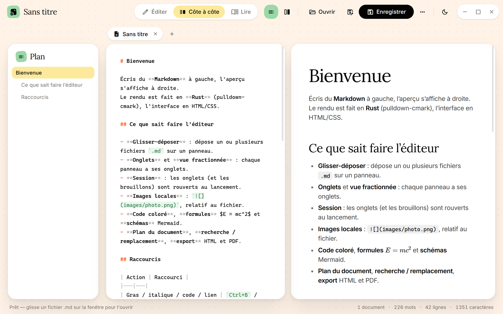
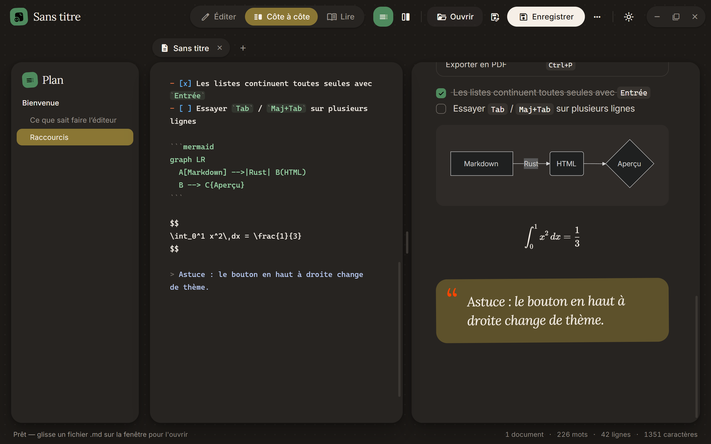

<p align="center">
  
</p>

<h1 align="center">Éditeur Markdown</h1>

<p align="center">
  Un éditeur Markdown léger pour Windows, écrit en <strong>Rust</strong> avec <strong>Tauri</strong>.<br>
  Aperçu en direct, onglets, code coloré, formules, schémas, export HTML et PDF.
</p>

<p align="center">
  <a href="https://github.com/DioNando/rust-markdown-editor/releases/latest"><strong>⬇ Télécharger la dernière version</strong></a>
</p>





---

## Fonctionnalités

**Écrire**
- Éditeur avec coloration de la syntaxe Markdown
- Raccourcis de mise en forme : `Ctrl+B` gras, `Ctrl+I` italique, `Ctrl+E` code, `Ctrl+K` lien
- Les listes (à puces, numérotées, à cocher) et les citations continuent avec `Entrée`
- `Tab` / `Maj+Tab` pour indenter ou désindenter plusieurs lignes
- Rechercher / remplacer (`Ctrl+F` / `Ctrl+H`)

**Lire**
- Aperçu en direct, avec trois modes : éditer, côte à côte, lire
- Défilement de l'éditeur et de l'aperçu calé sur les titres, dans les deux sens
- Images locales (``, relatives au fichier)
- Code coloré, formules mathématiques `$…$` / `$$…$$` et schémas [Mermaid](https://mermaid.js.org/), sans connexion
- Plan du document cliquable (`Ctrl+Maj+O`)
- Thèmes clair et sombre, interface responsive

**Organiser**
- Onglets, et vue fractionnée en deux panneaux avec chacun ses onglets (`Ctrl+\`)
- Glisser-déposer de fichiers `.md`
- Liens vers d'autres fichiers `.md` ouverts dans un onglet
- Session restaurée au lancement, avec récupération des brouillons après un plantage
- Fichiers récents, et détection des fichiers modifiés par un autre programme
- Une seule fenêtre : ouvrir un autre `.md` l'ajoute en onglet

**Partager**
- Export en page HTML autonome
- Export en PDF (`Ctrl+P`)

## Installation

Télécharge l'un des deux fichiers depuis la page [Releases](https://github.com/DioNando/rust-markdown-editor/releases/latest) (Windows 10/11, 64 bits) :

| Fichier | Pour quoi faire |
|---|---|
| `Editeur-Markdown_x.y.z_x64-setup.exe` | Installateur (≈ 3 Mo), sans droits administrateur. Il ajoute un raccourci au menu Démarrer et associe les fichiers `.md`. |
| `Editeur-Markdown_x.y.z_x64-portable.exe` | Version portable (≈ 10 Mo), à lancer sans installation. |

L'app s'appuie sur WebView2, déjà présent sur Windows 10/11 à jour.

> Les exécutables ne sont pas signés. Au premier lancement, Windows SmartScreen peut afficher « Windows a protégé votre ordinateur ». Clique sur **Informations complémentaires**, puis **Exécuter quand même**.

## Raccourcis

| Action | Raccourci |
|---|---|
| Ouvrir / enregistrer / enregistrer sous | `Ctrl+O` / `Ctrl+S` / `Ctrl+Maj+S` |
| Nouvel onglet / fermer l'onglet | `Ctrl+T` / `Ctrl+W` |
| Onglet suivant / précédent | `Ctrl+Tab` / `Ctrl+Maj+Tab` |
| Gras / italique / code / lien | `Ctrl+B` / `Ctrl+I` / `Ctrl+E` / `Ctrl+K` |
| Rechercher / remplacer | `Ctrl+F` / `Ctrl+H` |
| Plan du document | `Ctrl+Maj+O` |
| Fractionner la vue | `Ctrl+\` |
| Exporter en PDF | `Ctrl+P` |

## Contenu du dépôt

Le dépôt contient deux versions de l'éditeur :

| Dossier | Version | Description |
|---|---|---|
| [`MarkdownTauri/`](MarkdownTauri) | **Tauri** (principale) | Backend Rust, interface HTML/CSS/JS rendue par WebView2. C'est la version publiée dans les releases. |
| [`Markdown/`](Markdown) | egui | Version minimale 100 % Rust (eframe + egui_commonmark) : éditeur, aperçu, ouvrir / enregistrer, thème. Plus légère en mémoire, mais avec une mise en page plus limitée. |

Les fichiers `DESIGN*.md` sont les références de style qui ont servi à concevoir l'interface.

### Architecture de la version Tauri

```
MarkdownTauri/
├── src/main.rs        Backend Rust : rendu Markdown (pulldown-cmark), fichiers,
│                      session, images locales (protocole mdimg), instance unique
├── ui/
│   ├── index.html     Structure de l'interface
│   ├── main.js        Onglets, panneaux, recherche, plan, session, export…
│   ├── highlight.js   Coloration syntaxique de l'éditeur
│   ├── enhance.js     Enrichissement de l'aperçu : code, formules, schémas
│   ├── style.css      Design « Craft » (thèmes clair et sombre)
│   └── vendor/        highlight.js, KaTeX, Mermaid (embarqués, sans CDN)
├── icons/             Icône de l'application
└── tauri.conf.json    Fenêtre, sécurité (CSP), installateur NSIS
```

Le rendu Markdown est fait en Rust à chaque frappe. Le HTML brut présent dans un document est affiché comme du texte, donc un fichier `.md` piégé ne peut pas exécuter de script dans l'app.

## Compiler depuis les sources

Prérequis : [Rust](https://rustup.rs/) (édition 2024) et, pour l'installateur, [Node.js](https://nodejs.org/).

```sh
# Version Tauri : lancer en développement
cd MarkdownTauri
cargo run

# Tests
cargo test

# Exécutable optimisé + installateur Windows (NSIS)
npx @tauri-apps/cli@2 build
# → target/release/md_tauri.exe
# → target/release/bundle/nsis/Editeur Markdown_<version>_x64-setup.exe
```

```sh
# Version egui
cd Markdown
cargo run --release
```

## Bibliothèques et polices

- [Tauri](https://tauri.app/) : fenêtre et pont Rust ⇄ interface
- [pulldown-cmark](https://github.com/pulldown-cmark/pulldown-cmark) : analyse et rendu Markdown
- [highlight.js](https://highlightjs.org/) (BSD-3), [KaTeX](https://katex.org/) (MIT), [Mermaid](https://mermaid.js.org/) (MIT)
- Polices [Inter](https://rsms.me/inter/) et [Lora](https://github.com/cyrealtype/Lora-Cyrillic) (SIL OFL), icônes [Material Symbols](https://fonts.google.com/icons) (Apache 2.0)
- Pictogramme de l'application : « document code » de [SVG Repo](https://www.svgrepo.com/)
